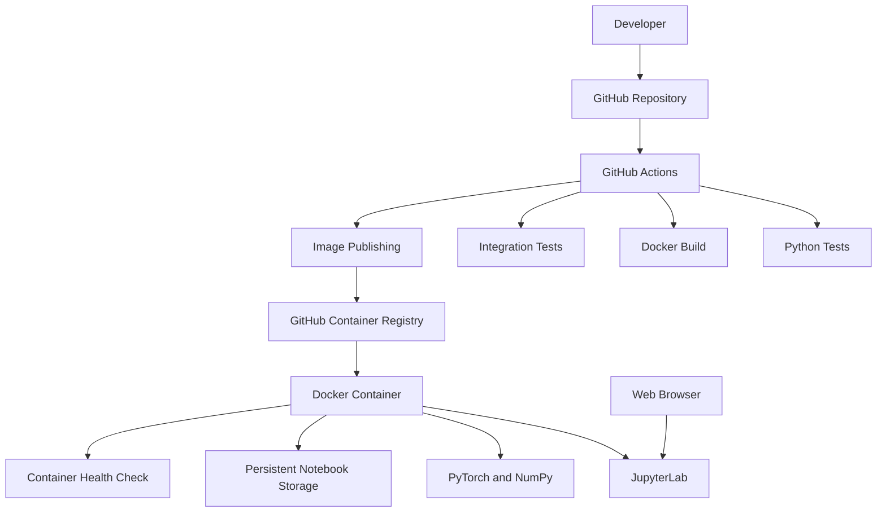
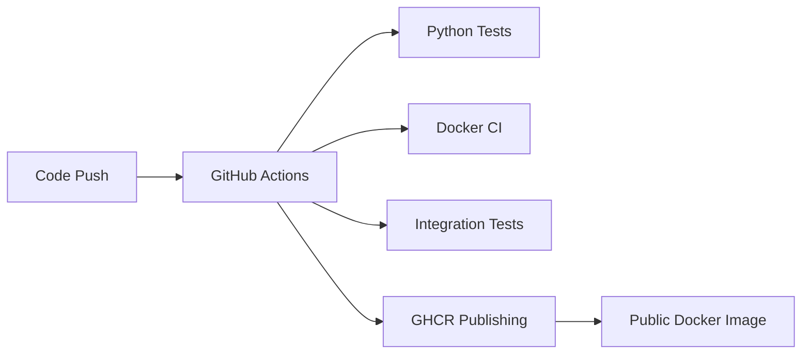

# Jupyter-x-Docker

### Containerized JupyterLab Environment for AI, Machine Learning and Data Science


[](https://github.com/VinaykumarDokku/Jupyter-x-Docker/actions/workflows/ghcr.yml)
[](https://github.com/VinaykumarDokku/Jupyter-x-Docker/actions/workflows/integration-tests.yml)
[](https://github.com/VinaykumarDokku/Jupyter-x-Docker/actions/workflows/publish.yml)
[](https://github.com/VinaykumarDokku/Jupyter-x-Docker/actions/workflows/python-tests.yml)

## Project Overview

Jupyter-x-Docker provides a containerized development environment
for Python programming, machine learning, artificial intelligence,
data analysis, and interactive experimentation.

The project combines Docker, JupyterLab, automated testing,
persistent notebook storage, and GitHub Actions to simplify
development and container distribution.

Developers can build the environment locally or download a
prebuilt Docker image from GitHub Container Registry.

## Key Features

- Containerized JupyterLab development environment.
- Docker Compose for simplified application management.
- Persistent notebook storage.
- Token-based Jupyter authentication.
- CPU-based PyTorch support.
- NumPy and PyTorch runtime compatibility.
- Automated Python tests.
- Docker integration and storage persistence tests.
- Container health monitoring.
- Automated Docker image publishing.
- GitHub Actions CI/CD workflows.
- Docker build caching.
- Linux AMD64 compatibility on Apple Silicon through emulation.
- Public container image distribution through GHCR.

## System Architecture



## Technology Stack

| Technology | Purpose |
|---|---|
| Python 3.9 | Application runtime |
| JupyterLab | Interactive development |
| Docker | Application containerization |
| Docker Compose | Container orchestration |
| PyTorch 1.10.1+cpu | Deep learning |
| NumPy 1.26.4 | Numerical computing |
| GitHub Actions | CI/CD automation |
| GitHub Container Registry | Docker image distribution |
| Pipenv | Dependency management |
| Shell Scripting | Automation and integration testing |

## Project Structure

```text
Jupyter-x-Docker/
├── .github/
│   └── workflows/
├── configuration/
│   └── jupyter.py
├── root/
├── scripts/
│   ├── entrypoint.sh
│   ├── health_check.py
│   └── integration_test.sh
├── tests/
├── .dockerignore
├── .gitignore
├── compose.yaml
├── Dockerfile
├── Pipfile
├── Pipfile.lock
└── README.md
```

## Prerequisites

- Docker Desktop or Docker Engine
- Docker Compose V2
- Git
- A modern web browser

No separate local Python installation is required to run
the prebuilt Docker image.

## Quick Start

### Option 1: Run the Published Docker Image

Download the public Docker image:

```bash
docker pull --platform linux/amd64 \
  ghcr.io/vinaykumardokku/jupyter-x-docker:latest
```

Start the container with persistent notebook storage:

```bash
docker run -d \
  --name jupyter-ml \
  --platform linux/amd64 \
  -p 127.0.0.1:8888:8888 \
  -v jupyter-notebooks:/app/notebooks \
  ghcr.io/vinaykumardokku/jupyter-x-docker:latest
```

Retrieve the Jupyter authentication token:

```bash
docker exec jupyter-ml jupyter server list
```

Open the following address in your browser:

http://localhost:8888/lab

Use the token displayed by the previous command.

### Option 2: Build Locally with Docker Compose

Clone the repository:

```bash
git clone https://github.com/VinaykumarDokku/Jupyter-x-Docker.git
cd Jupyter-x-Docker
```

Build and start the application:

```bash
docker compose up --build -d
```

Check the container status:

```bash
docker compose ps
```

Retrieve the authentication token:

```bash
docker compose exec jupyter jupyter server list
```

Open JupyterLab using the host port configured in compose.yaml.

## Machine Learning Runtime Verification

Verify PyTorch and NumPy using the published image:

```bash
docker run --rm --platform linux/amd64 \
  ghcr.io/vinaykumardokku/jupyter-x-docker:latest \
  python -c 'import numpy; import torch; print("NumPy:", numpy.__version__); print("PyTorch:", torch.__version__); print(torch.rand(2,3).numpy())'
```

Verified runtime versions:

```text
NumPy: 1.26.4
PyTorch: 1.10.1+cpu
```

The successful conversion of a PyTorch tensor into a NumPy
array confirms interoperability between both libraries.

## Example Machine Learning Experiment

Create a Python notebook in JupyterLab and execute:

```python
import numpy as np
import torch

x = torch.tensor([[1.0], [2.0], [3.0], [4.0]])
y = 2 * x + 1

model = torch.nn.Linear(1, 1)
optimizer = torch.optim.SGD(model.parameters(), lr=0.01)
loss_function = torch.nn.MSELoss()

for epoch in range(2000):
    prediction = model(x)
    loss = loss_function(prediction, y)

    optimizer.zero_grad()
    loss.backward()
    optimizer.step()

with torch.no_grad():
    result = model(torch.tensor([[5.0]]))

print("Prediction:", result.item())
print("NumPy output:", result.numpy())
```

The example demonstrates model training, optimization,
prediction, and PyTorch-to-NumPy conversion.

## Persistent Notebook Storage


Persistent storage allows notebook files to survive container
restarts and recreation when the same storage mount is reused.

Stop the Compose application:

```bash
docker compose down
```

Restart the application:

```bash
docker compose up -d
```

Avoid removing Docker volumes unless you intentionally want
to delete the data stored in them.

## Automated Testing

### Python Tests

The Python test suite validates project functionality
and supporting scripts.

Python tests are executed through GitHub Actions.

### Container Health Check

Check the running container:

```bash
docker inspect --format='{{.State.Health.Status}}' jupyter-ml
```

Expected result after initialization:

```text
healthy
```

The health check script verifies that the Jupyter HTTP
server responds successfully.

### Docker Integration Testing

The integration workflow validates container functionality
and persistent notebook storage.

Run the integration script from the repository:

```bash
bash scripts/integration_test.sh
```

## CI/CD Pipeline



The repository contains four automated workflows:

| Workflow | Responsibility |
|---|---|
| Python Tests | Automated Python validation |
| Jupyter Docker CI | Docker build validation |
| Docker Integration Tests | Container and storage testing |
| Publish Docker Image to GHCR | Image building and publishing |

All four workflows passed for commit c798754,
including the NumPy compatibility update.

View workflow execution:

https://github.com/VinaykumarDokku/Jupyter-x-Docker/actions

## Docker Image Distribution

Registry: GitHub Container Registry

Public image:

```text
ghcr.io/vinaykumardokku/jupyter-x-docker:latest
```

Package page:

https://github.com/VinaykumarDokku/Jupyter-x-Docker/pkgs/container/jupyter-x-docker

Automated publishing simplifies image distribution by allowing
developers to download the environment without building it locally.

## Engineering Improvements

Recent improvements include:

- Docker health check implementation.
- Automated Python validation.
- Docker Compose configuration.
- JupyterLab integration.
- Persistent notebook storage.
- Apple Silicon architecture compatibility.
- Automated Docker integration testing.
- Public GHCR image publishing.
- Docker build caching.
- PyTorch runtime dependency fixes.
- NumPy compatibility fixes.
- Removal of hardcoded Jupyter authentication configuration.

## Troubleshooting

### PyTorch Installation Fails on Apple Silicon

Use the Linux AMD64 platform when running the Docker image:

```bash
docker pull --platform linux/amd64 \
  ghcr.io/vinaykumardokku/jupyter-x-docker:latest
```

### NumPy Compatibility Warning

The project uses NumPy 1.26.4 for compatibility
with the legacy PyTorch 1.10.1 runtime.

### pkg_resources Deprecation Warning

Older PyTorch releases depend on pkg_resources.
The warning does not prevent the verified runtime
from executing successfully.

### Port Already in Use

Use another available host port, such as 8889,
when starting a new container.

### View Application Logs

```bash
docker compose logs --tail=100 jupyter
```

Or, for the standalone container:

```bash
docker logs jupyter-ml
```

## Security Considerations

- Keep Jupyter authentication enabled.
- Never commit authentication tokens or credentials.
- Bind local development ports to localhost.
- Do not expose the development server directly to the internet.
- Review and update legacy dependencies before production deployment.
- Back up important notebooks and datasets.

## Use Cases

- Machine learning experimentation.
- Python development and education.
- Data science research.
- Deep learning model prototyping.
- Reproducible development environments.
- Docker and DevOps demonstrations.
- CI/CD automation practice.

## Future Enhancements

- Upgrade to supported Python and PyTorch versions.
- Native ARM64 container support.
- GPU-enabled Docker images.
- Container vulnerability scanning.
- Automated dependency updates.
- Software Bill of Materials generation.
- Versioned container releases.
- Cloud deployment with secure authentication.

## Maintainer

**Vinay Kumar Dokku**

Software Engineering | Full-Stack Development | AI/ML | DevOps

- GitHub: https://github.com/VinaykumarDokku
- Portfolio: https://vinaykumardokku.github.io/

## Acknowledgments

This project builds upon an earlier Jupyter and Docker
deployment implementation, with additional container management,
testing, CI/CD, storage, and dependency compatibility improvements.

Existing upstream contributions and applicable license terms
should be retained and respected.

